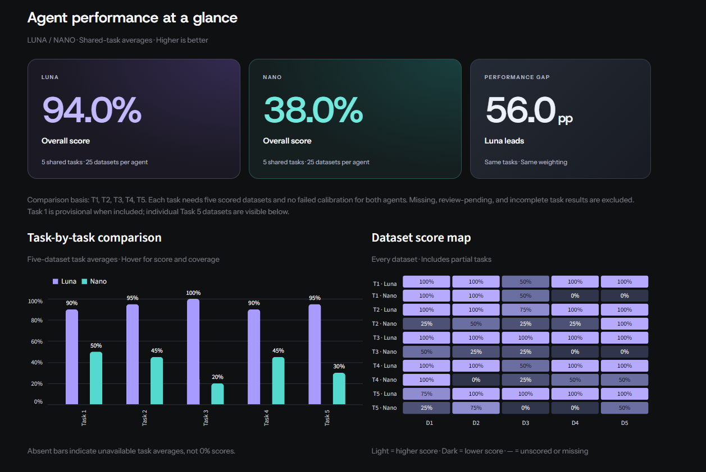
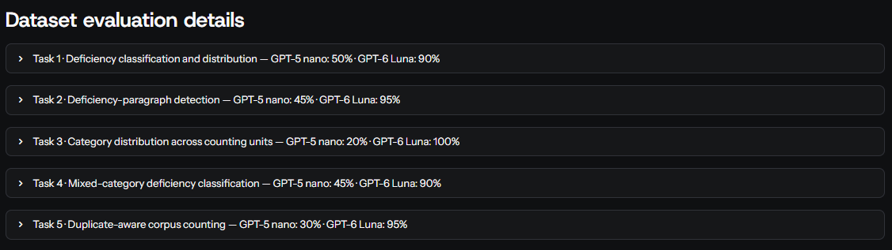

# RegEval Task Design and Evaluation

This is **Project 2** in the [monorepo](../README.md). Run all project commands from this directory. See the root README for setup, test, and Docker commands.

Built for the **Raycaster track** at the **DNAForge & MTC Berkeley AI × Biology Hackathon** (November 14, 2026).

[Project 2 write-up](https://docs.google.com/document/d/1QcurBNNxOV6pxa4GAyLgIPev5JUpa62VH3cpaREwNrc/edit?usp=sharing)

RegEval evaluates agents on FDA Complete Response Letter workflows through five tasks with five datasets each. A shared dashboard runs evaluations and preserves answers, judgments, model comparisons, and run history.

## User workflow

1. Choose a task and datasets, then review the instructions and evaluation criteria.
2. Select the agent and judge models, using both locally for local inference.
3. Run the evaluation and inspect scores, answers, and judge feedback.
4. Compare models and revisit saved runs to investigate failures.

**Local execution for data safety.** A key differentiator is support for Qwen3 1.7B through Ollama as both agent and judge. When both roles are local, evaluation inference stays on the machine, helping protect sensitive regulatory documents. Local failures never trigger a hosted-model fallback. Local judging remains experimental and needs separate calibration.

**Task design and checks.** Our 25 datasets test deficiency detection, classification, aggregation, mixed labels, and duplicate detection. Hidden golden datasets provide reference answers. Negative controls test whether agents exclude nonblocking recommendations and avoid merging distinct records. Each dataset has four equally weighted pass/fail checks. Python validates formats and aggregates scores; independent SQL calculations verified all 75 golden fractions in the aggregation task.

**Validating the LLM judge.** Separate GPT-6 Luna calls grade answers against rubrics and reference evidence. We started with expected-correct answers, deliberately introduced errors such as wrong counts, missing evidence, or incorrect record merges, and checked whether the judge failed the affected checks. Correct reference answers had to score 100%; empty or wholly wrong answers had to score 0%. Tasks 2–4 passed 22, 22, and 24 calibration probes, respectively; Task 5 passed 15 endpoint checks across five datasets.

**Evidence that tests reflect agent ability.** With identical inputs and no access to golden answers, GPT-6 Luna outperformed GPT-5 nano: 95% versus 45% on detection and 100% versus 20% on aggregation. This matches the expected capability ranking and, alongside judge calibration, supports the evaluation’s ability to distinguish agent performance. Luna also averaged 95% on Task 5. These results provide initial validation, not proof of general scoring accuracy.

**Concrete failures and changes.** In Task 2, Dataset 4, Nano selected nonblocking recommendations despite recognizing their status; in Task 3, Dataset 4, it returned zero denominators and null percentages. These suggest inconsistent inclusion decisions and confusion about counting populations. Our design addresses these risks by separating detection from aggregation, specifying inclusion rules and denominators, and independently checking golden arithmetic. In Task 4, the same Luna answer received 50% and 25% because judges interpreted citation sufficiency differently. We withheld the disputed result, preserved both judgments, and generated a fresh answer; its 50% score did not resolve the original disagreement. We also fixed a runner bug that rejected Nano’s dated model identifier and recovered five saved responses without regenerating them.

**Limits.** Task 1 remains provisional, expert review is incomplete, and candidate/judge biases may overlap.

**Next steps.** Expand the tests, datasets, and failure cases, then cover the other Raycaster challenges to build a unified, all-in-one agent evaluation system.

## UI screenshots

